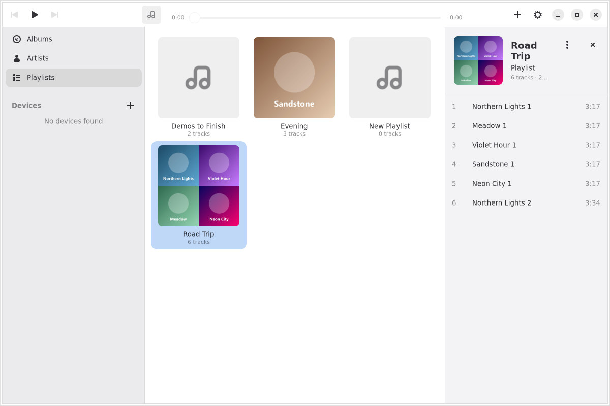
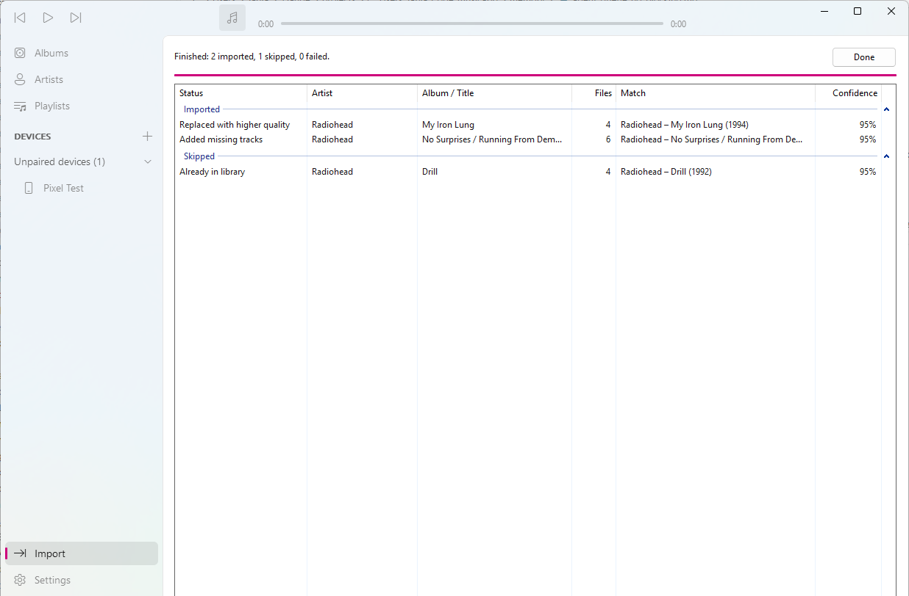
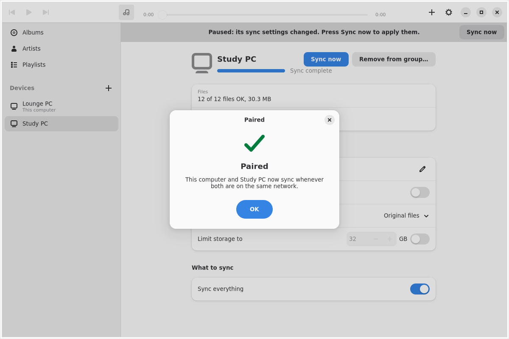
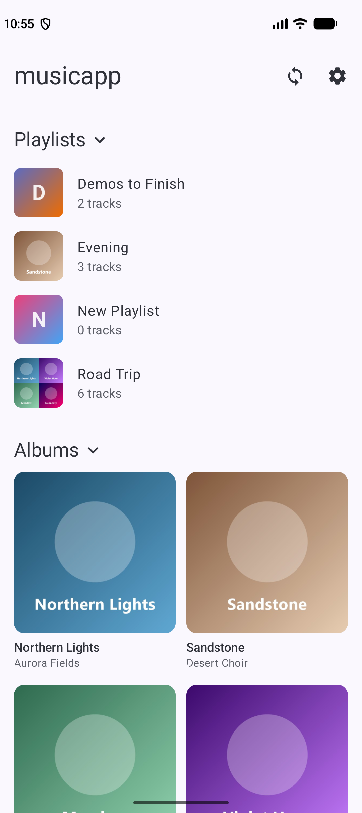

## One library, in order

Drop folders on the window and Kithsong copies them into one library folder, organised by
artist and album, with cover art for every album. Your originals are never changed, and
singles live together instead of becoming one-track albums.

## Tagged for you

Everything you import is matched against MusicBrainz in one go. Confident matches go
straight in. Anything Kithsong isn't sure about waits for you: pick a match, search again,
or keep the tags you have.

## Sync without the cloud

Your devices find each other on your local network. Pair them once with a short code and
they sync whenever they're both online: music, playlists and edits. Phones can ask for
smaller copies instead of the original files.

## On your phone and watch

The Android app carries your whole library, or just the part you choose to sync, and
there's a Wear OS app for your watch too.
