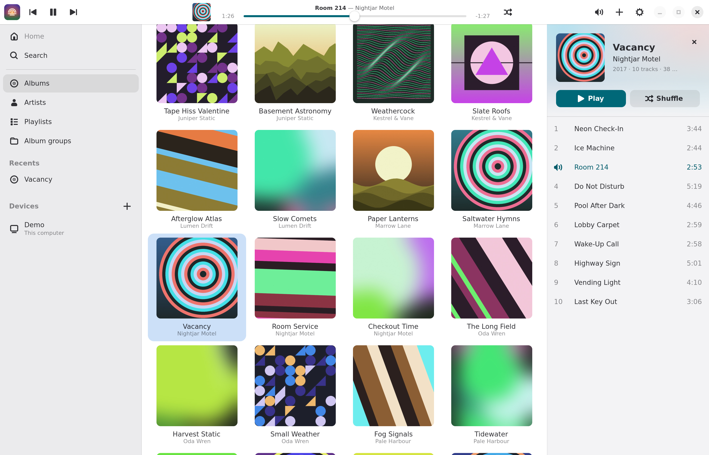
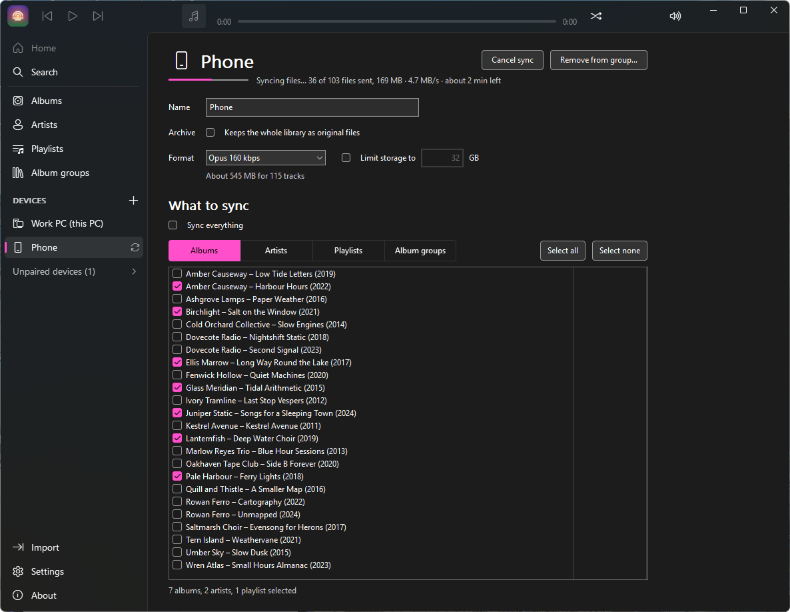
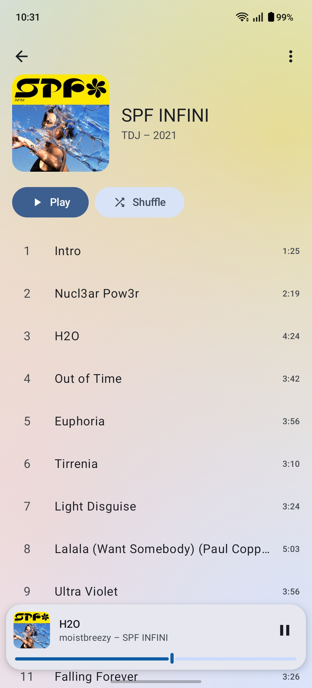

## Organised Library

The library folder holds all of your music, organised against the database. Import from a folder or zip file and it'll be searched against MusicBrainz and its tags cleaned up. Kithsong automatically searches for cover art if it's missing or low quality.

## Local Sync

Discover devices automatically over the local network and pair them with a 6 digit code. No server or cloud required, libraries are merged field by field when synced so everything is kept up to date. Your main library is considered an "Archive" - it keeps the originals of your entire library in one place. Sync lossy Opus files to low-storage devices to save space, or selectively sync only a few albums. 

## Devices

Take your music with you. Windows laptop, Linux workstation, Android phone, WearOS smartwatch. Have your original library on your workstation and sync a subset to your phone, or transcoded files to your laptop. Sync just a playlist or two to your smartwatch.